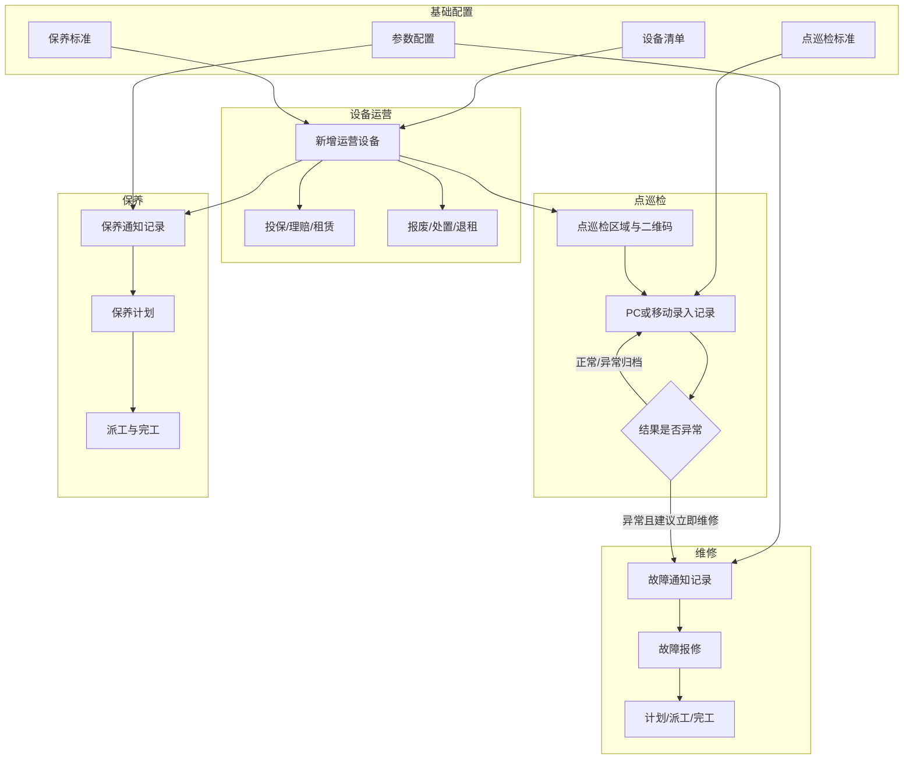
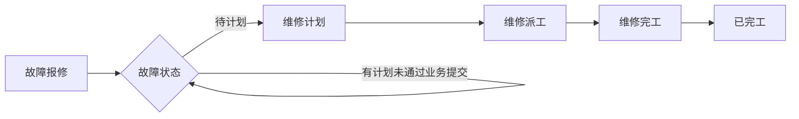
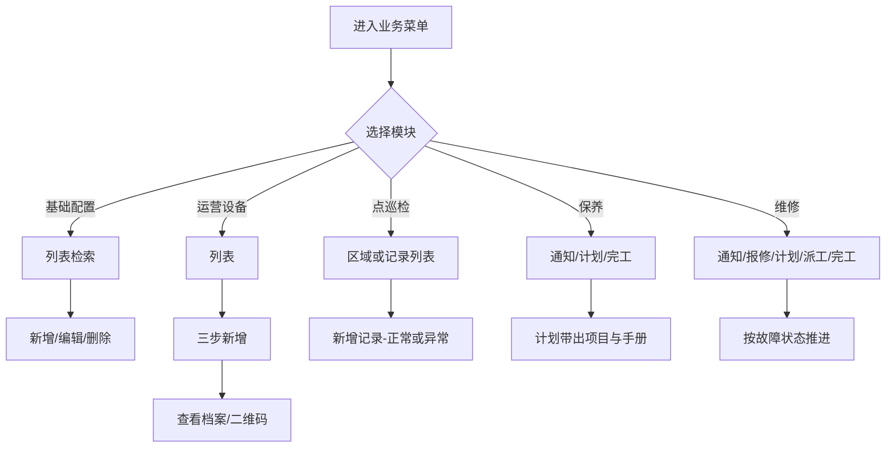
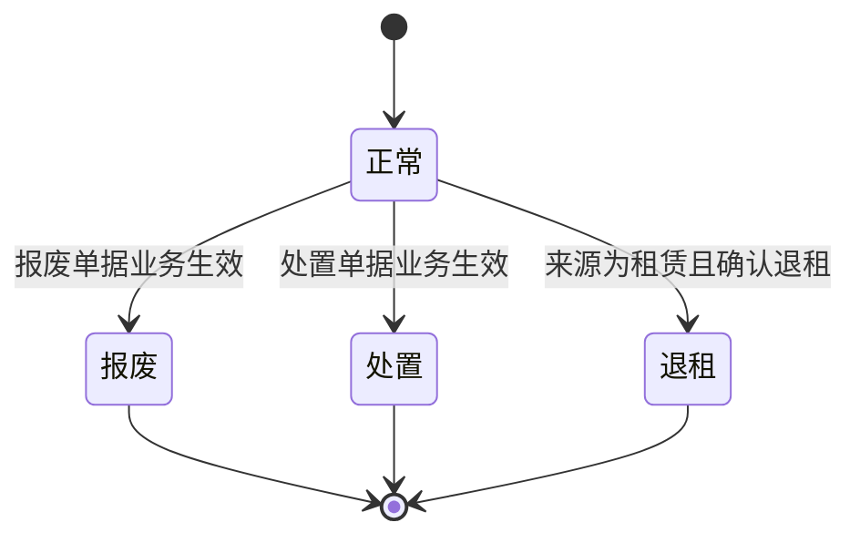
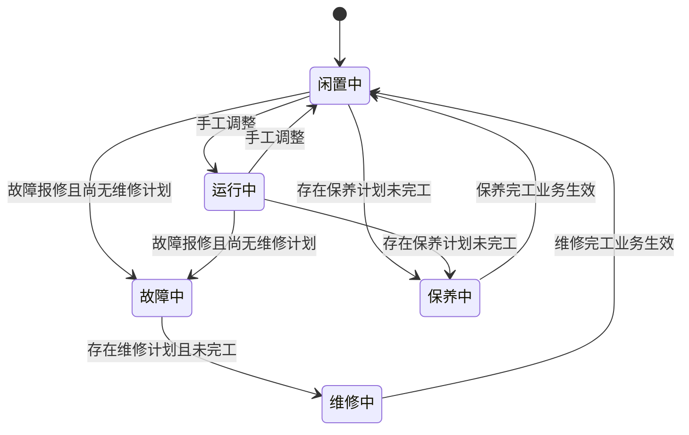
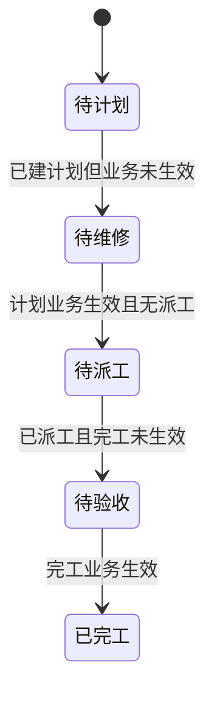
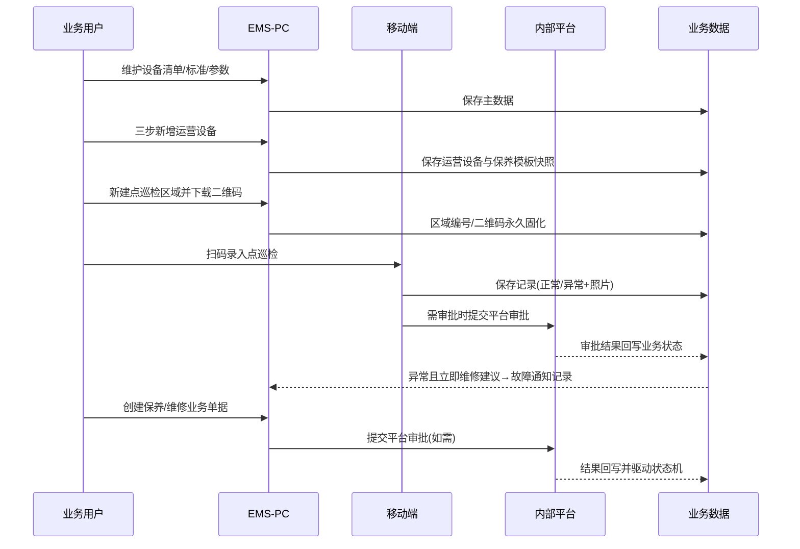
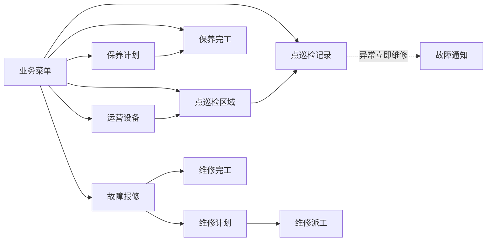

# 智能设备管理（EMS）产品需求文档

| 字段 | 内容 |
|------|------|
| 产品名称 | 智能设备管理（EMS） |
| 当前版本 | v1.1.0 |
| 版本更新时间 | 2026-09-03 |
| 版本迭代说明 | 版本骨架：自 v1.0.0 复制建立，本版功能范围待补充 |
| 文档状态 | 版本已创建，内容待说明 |
| 需求主源 | 资料/智能设备管理PRD.docx、资料/axure文件（分析重构） |

---

## 目录

- [1. 产品概述](#1-产品概述)
- [2. 范围说明](#2-范围说明)
- [3. 业务流程](#3-业务流程)
- [4. 功能模块总览](#4-功能模块总览)
- [5. 用户交互路径 User Flows](#5-用户交互路径-user-flows)
- [6. 页面清单与跳转关系](#6-页面清单与跳转关系)
- [7. 非功能性需求](#7-非功能性需求)
- [8. 优先级与迭代建议](#8-优先级与迭代建议)
- [9. 风险项](#9-风险项)
- [10. 待确认](#10-待确认)

---

## 1. 产品概述

### 1.1 产品定位

智能设备管理（EMS）面向生产现场大型设备的 **主数据与全生命周期运营管理**：以「设备清单（模板）→ 运营设备（在场实例）→ 点巡检区域」为主数据骨架，串联点巡检、保养、维修、运行记录，并支持移动端扫码录入巡检结果，形成可追溯的设备运维闭环。

本产品搭建在公司统一内部平台之上。以下能力由平台统一提供，**本 PRD 不设计对应模块、页面与交互**：

| 平台公共能力 | 说明 |
|--------------|------|
| 消息中心 | 站内通知、待办、推送、消息列表 |
| 流程审批 | 审批发起、节点、抄送、驳回、审批记录 |
| 角色 / 菜单 / 按钮 / 数据权限 | 统一权限配置 |

业务侧仅定义：**业务单据、业务状态、业务操作、与平台能力的衔接点**（如「提交后进入平台审批」），不重复设计审批/消息/权限界面。

### 1.2 产品目标

| 目标 | 说明 | 优先级 |
|------|------|--------|
| 主数据统一 | 设备清单与运营设备分层管理，编号唯一、引用可校验 | P0 |
| 巡检闭环 | 区域二维码 + PC/移动录入，异常带照片与维修建议 | P0 |
| 保养可预期 | 周期/专项保养计划、派工、完工，自动计算下次保养并生成业务通知记录 | P0 |
| 维修可追溯 | 报修→计划→派工→完工，故障状态机清晰 | P0 |
| 运营可管理 | 投保/理赔、租赁、报废、处置、加油等运营单据可查可管 | P1 |
| 兼容迁移 | 点巡检区域编号映射老系统；二维码永久不变 | P0 |

### 1.3 用户角色定义

| 角色 | 职责 | 主要使用端 |
|------|------|------------|
| 设备管理员 | 主数据维护、运营设备建档、报废/处置/租赁单据 | PC |
| 维保负责人 | 保养计划、派工、完工验收 | PC |
| 巡检人员 | 现场点巡检录入（扫码） | 移动端 |
| 维修人员 | 故障报修协同、维修计划/派工/完工业务录入 | PC / 移动（【待确认】） |
| 生产/运行人员 | 查看设备状态、加油记录等 | PC |
| 业务查看者 | 只读查看通知汇总、设备档案 | PC |

> 具体角色与数据权限由平台配置；本 PRD 仅描述业务可见范围建议，不产出权限配置页。

---

## 2. 范围说明

### 2.1 包含（In Scope）— v1.0.0

| 模块 | 二级功能 | 优先级 |
|------|----------|--------|
| 基础配置 | 设备清单、保养标准、点巡检标准、参数配置 | P0 |
| 设备运营 | 运营设备、投保记录、理赔记录、设备租赁、设备报废、设备处置 | P0/P1 |
| 点巡检管理 | 点巡检区域、点巡检记录 | P0 |
| 保养管理 | 保养通知（业务汇总）、保养计划、保养完工 | P0 |
| 设备维修 | 故障通知（业务汇总）、故障报修、维修计划、维修派工、维修完工 | P0 |
| 运行管理 | 加油记录 | P1 |
| 移动端 | 扫码点巡检录入（独立 App 或企微 H5，形态见确认表单） | P0 |

### 2.2 不包含（Out of Scope）

| 项 | 原因 |
|----|------|
| 消息中心 / 审批流 / 角色权限页面 | 平台公共能力 |
| 流程配置业务页 | 审批由平台承载；本版不单独做流程配置 |
| 计量单位、技术图纸、前期资料、故障停机记录、运行记录（Axure「备用」） | 资料未形成完整需求，本版不纳入 |
| 物联网实时采集 / 大屏看板 | 原资料未覆盖 |

---

## 3. 业务流程

### 3.1 完整业务流程图

**文字解读：** 先配主数据与标准，再建运营设备与巡检区域；巡检异常可沉淀故障通知；保养按周期触发通知后走计划与完工；维修从报修到完工闭环；运营侧并行处理投保、租赁与退出类单据。

### 3.2 子业务流程 — 保养闭环

**文字解读：** 非首次保养以「上次验收日 + 周期」计算；首次以录入/投用相关日期 + 周期计算（细则见【待确认】）。专项保养完工不回写「下次保养」。

### 3.3 子业务流程 — 维修闭环

**文字解读：** 一故障可多计划；一计划一次派工；一故障一次完工验收。计划可作废（已派工则不可）。

### 3.4 用户交互流程图（PC 主路径）

### 3.5 流程状态机

#### 3.5.1 运营设备状态

#### 3.5.2 运行状态（设备状态=正常时）

#### 3.5.3 故障报修状态

> 「业务生效」指业务单据完成提交并由平台审批通过后的结果回写；审批 UI 不在本产品设计范围。

### 3.6 系统数据流转时序图

---

## 4. 功能模块总览

> 每个二级功能固定四维：功能介绍 / 前置条件 / 数据权限 / 页面跳转。  
> 列表默认按创建时间降序；删除前做关联校验。  
> **不含**审批操作按钮、消息入口、权限配置入口。

### 4.1 基础配置

#### 4.1.1 设备清单

| 维度 | 说明 |
|------|------|
| 功能介绍 | 构建设备基础数据模板，供运营设备引用。 |
| 前置条件 | 用户可进入【基础配置→设备清单】；设备类型等字典可用。 |
| 数据权限 | 建议全量可见（由平台配置）；本模块不做行级过滤设计。 |
| 页面跳转 | 列表→新增/编辑/查看；删除失败 Toast「存在关联数据，无法删除」。 |

**关键规则（P0）**

| 项 | 规则 |
|----|------|
| 设备编号 | 唯一 |
| 设备属性/类型 | 数据字典 |
| 搜索 | 编号、名称 |
| 筛选 | 设备类型 |
| 删除 | 若被运营设备引用则不可删 |
| 编辑 | 编号不可改；其余可改并同步引用展示 |

#### 4.1.2 保养标准

| 维度 | 说明 |
|------|------|
| 功能介绍 | 作为设备保养模板，便于运营设备引用保养项目。 |
| 前置条件 | 进入【基础配置→保养标准】。 |
| 数据权限 | 建议全量可见。 |
| 页面跳转 | 列表→新增/编辑/查看；选择弹窗可被运营设备、计划页复用。 |

**关键规则（P0）**

| 项 | 规则 |
|----|------|
| 适用设备类型 | 多选 |
| 保养项目 | 至少一条完整（保养类别+保养内容） |
| 删除项目行 | 仅当项目数>1 时显示删除 |
| 编辑 | 可改；已生成的历史保养记录按值快照，不回溯改历史 |

#### 4.1.3 点巡检标准

| 维度 | 说明 |
|------|------|
| 功能介绍 | 定义点巡检检查项标准，供巡检记录填写。 |
| 前置条件 | 进入【基础配置→点巡检标准】。 |
| 数据权限 | 建议全量可见。 |
| 页面跳转 | 列表→新增/编辑/查看；支持启停。 |

**关键规则（P0）**

| 项 | 规则 |
|----|------|
| 标准编码 | 4 位，不可重复 |
| 启用 | 默认开启；禁用后新巡检可不填该标准，已填历史不受影响 |
| 删除 | 被巡检记录引用则不可删 |

#### 4.1.4 参数配置

| 维度 | 说明 |
|------|------|
| 功能介绍 | 配置点巡检/保养/故障相关业务通知参数（时间、提前天数、渠道偏好等）。 |
| 前置条件 | 进入【基础配置→参数配置】。 |
| 数据权限 | 建议仅管理员可改。 |
| 页面跳转 | 单页表单保存；实际触达由平台消息中心执行，本模块只维护配置与业务通知落库规则。 |

**配置项（P0）**

| 分组 | 字段要点 |
|------|----------|
| 点巡检通知 | 每日通知时间；通知人员（多选）；渠道偏好（站内信/企业微信，由平台送达）；默认关闭 |
| 保养通知 | 距离保养到期提前天数（正整数）；通知详情模板字段 |
| 故障通知 | 通知详情模板；可引用点检故障描述字段 |

---

### 4.2 设备运营

#### 4.2.1 运营设备

| 维度 | 说明 |
|------|------|
| 功能介绍 | 管理在场生产大型设备实例，是全模块核心主数据。 |
| 前置条件 | 已有设备清单；保养标准可选。 |
| 数据权限 | 建议按组织/产线过滤（平台配置）。 |
| 页面跳转 | 列表→三步新增；查看（基础/维保/制造/二维码）；编辑/复制/退租/删除/下载二维码。 |

**新增三步（P0）**

| 步骤 | 内容 |
|------|------|
| 第一步 | 选择设备清单；运营设备编号唯一；来源字典；状态固定正常；运行状态限闲置/运行；安装/投用日期校验；图片可带入可改 |
| 第二步 | 定期保养：维保负责人、周期、保养项目（可选标准累加，至少一条完整）；专项保养可多组可空 |
| 第三步 | 制造信息：出厂日期、联系方式（手机号）等 |

**列表与状态操作（P0）**

| 设备状态 | 可用操作 |
|----------|----------|
| 正常 | 查看、编辑、复制、退租（租赁）、设备二维码、删除 |
| 报废/处置/退租 | 查看、删除（删除仍需关联校验） |

| 其他规则 | 说明 |
|----------|------|
| 二维码 | 新增后永久不变；打包下载命名：运营设备编号+名称；压缩包含下载日期 |
| 复制 | 确认后新编号，其余拷贝 |
| 退租 | 仅来源=租赁；确认后不可逆 |
| 筛选 | 类型、来源、属性、设备状态/运行状态（级联） |

#### 4.2.2 投保记录

| 维度 | 说明 |
|------|------|
| 功能介绍 | 记录运营设备投保信息。 |
| 前置条件 | 存在状态=正常的运营设备。 |
| 数据权限 | 建议按组织可见。 |
| 页面跳转 | 列表→新增/编辑/查看；选择运营设备弹窗。 |

**关键规则（P1）**

| 项 | 规则 |
|----|------|
| 唯一性 | 同一运营设备下投保单号唯一 |
| 金额 | 元，两位小数 |
| 删除 | 存在理赔记录不可删 |

#### 4.2.3 理赔记录

| 维度 | 说明 |
|------|------|
| 功能介绍 | 基于投保记录登记理赔。 |
| 前置条件 | 已有投保记录。 |
| 数据权限 | 建议按组织可见。 |
| 页面跳转 | 列表→新增/编辑/查看；选择投保单号弹窗。 |

**关键规则（P1）**

| 项 | 规则 |
|----|------|
| 唯一性 | 理赔单号+运营设备唯一 |
| 切换投保单 | 跟随字段重置 |

#### 4.2.4 设备租赁

| 维度 | 说明 |
|------|------|
| 功能介绍 | 记录设备租赁业务单据与协议附件。 |
| 前置条件 | 可选正常运营设备。 |
| 数据权限 | 建议按组织可见。 |
| 页面跳转 | 列表→新增/编辑/查看/协议上传；提交后由平台审批，本页仅展示业务状态结果。 |

**关键规则（P1）**

| 项 | 规则 |
|----|------|
| 租赁周期 | 日期区间 |
| 数量 | 正整数 |
| 租金 | 元，两位小数 |
| 协议 | 业务通过后可上传（通用上传组件） |

#### 4.2.5 设备报废 / 4.2.6 设备处置

| 维度 | 报废 | 处置 |
|------|------|------|
| 功能介绍 | 自有设备报废申请单据 | 自有设备处置申请单据 |
| 前置条件 | 正常且来源=自有 | 同左 |
| 数据权限 | 建议按组织 | 同左 |
| 页面跳转 | 列表→新增/编辑/查看→提交平台审批 | 同左 |

业务生效后回写运营设备状态为报废/处置，且不可手工改回。

---

### 4.3 点巡检管理

#### 4.3.1 点巡检区域

| 维度 | 说明 |
|------|------|
| 功能介绍 | 为运营设备划分巡检区域并生成区域二维码，支撑现场扫码。 |
| 前置条件 | 存在正常运营设备。 |
| 数据权限 | 建议按组织/设备范围。 |
| 页面跳转 | 列表→新增/编辑/查看/二维码预览下载；支持打包下载全部区域码。 |

**关键规则（P0）**

| 项 | 规则 |
|----|------|
| 区域编号 | 唯一；映射老系统设备编号，便于迁移 |
| 启用 | 默认开启 |
| 二维码 | 新增后永久不变；需与老系统已有码一致（迁移） |
| 打包命名 | 压缩包：点巡检二维码+日期；图片：设备名称+区域名称 |
| 删除 | 存在巡检记录不可删 |

#### 4.3.2 点巡检记录

| 维度 | 说明 |
|------|------|
| 功能介绍 | 记录每次点巡检结果，区分正常/异常，支撑后续故障联动。 |
| 前置条件 | 存在已启用区域；点巡检标准可用。 |
| 数据权限 | 建议按组织/负责人。 |
| 页面跳转 | 列表→新增正常/异常→查看照片；提交后如需审批走平台。 |

**关键规则（P0）**

| 项 | 规则 |
|----|------|
| 异常判定 | 任一点检项非正常即为异常 |
| 现场照片 | 异常必传；正常非必传 |
| 维修建议 | 异常必填，数据字典 |
| 负责人/部门 | 默认当前用户与所属部门，可改 |
| 兼容 | 兼容旧系统巡检数据同步 |

---

### 4.4 保养管理

#### 4.4.1 保养通知（业务汇总页）

| 维度 | 说明 |
|------|------|
| 功能介绍 | 汇总展示系统按规则生成的保养到期提醒业务记录（非消息中心）。 |
| 前置条件 | 运营设备已配置保养周期；参数已配提前天数。 |
| 数据权限 | 维保负责人相关数据优先（平台配置）。 |
| 页面跳转 | 列表→查看详情；只读，无新增。 |

#### 4.4.2 保养计划

| 维度 | 说明 |
|------|------|
| 功能介绍 | 制定周期保养或专项保养计划。 |
| 前置条件 | 正常运营设备；设备上已有保养项目/专项配置。 |
| 数据权限 | 建议按组织/维保负责人。 |
| 页面跳转 | 列表→新增（周期/专项）→查看/编辑；提交走平台审批。 |

**关键规则（P0）**

| 项 | 规则 |
|----|------|
| 带出 | 保养项目、操作手册只读预览 |
| 上次保养 | 回显最近验收日，无则空 |
| 计划时间 | 精确到分的时间范围 |
| 人员 | 保养人员/通知人员多选（组织架构） |

#### 4.4.3 保养完工

| 维度 | 说明 |
|------|------|
| 功能介绍 | 对已生效保养计划做派工登记与完工验收。 |
| 前置条件 | 存在已生效且未完工的保养计划。 |
| 数据权限 | 建议按组织/维保负责人。 |
| 页面跳转 | 列表→新增→选择计划→派工记录→完工信息。 |

**关键规则（P0）**

| 项 | 规则 |
|----|------|
| 作业时间 | 须晚于计划业务生效时间；同计划下不可交叉 |
| 下次保养 | 验收日+周期（专项无此字段） |
| 派工项目 | 默认完成，可查看 |

---

### 4.5 设备维修

#### 4.5.1 故障通知（业务汇总页）

| 维度 | 说明 |
|------|------|
| 功能介绍 | 汇总点巡检「立即维修」类建议触发的故障提醒业务记录。 |
| 前置条件 | 点巡检异常记录业务生效且建议为立即维修。 |
| 数据权限 | 建议按设备归属。 |
| 页面跳转 | 列表→查看；只读。 |

#### 4.5.2 故障报修

| 维度 | 说明 |
|------|------|
| 功能介绍 | 登记故障设备报修单，驱动故障状态机。 |
| 前置条件 | 正常运营设备。 |
| 数据权限 | 建议按组织。 |
| 页面跳转 | 列表→新增/查看；删除需无关联计划。 |

**关键规则（P0）**

| 项 | 规则 |
|----|------|
| 故障发生时间 | 精确到分，且小于当前时间 |
| 筛选 | 故障状态、类型、严重程度、发生时间 |

#### 4.5.3 维修计划 / 4.5.4 维修派工 / 4.5.5 维修完工

| 功能 | 介绍 | 前置 | 跳转要点 |
|------|------|------|----------|
| 维修计划 | 针对未完工故障制定计划 | 存在可计划故障单 | 新增选故障→编辑；可作废（无派工） |
| 维修派工 | 一计划一次派工 | 计划已生效且未派工且故障未完工 | 新增选计划→编辑/删除 |
| 维修完工 | 一故障一次验收 | 故障尚未完工 | 回显全部计划与派工→验收 |

计划维修时间须大于故障报修时间。

---

### 4.6 运行管理

#### 4.6.1 加油记录

| 维度 | 说明 |
|------|------|
| 功能介绍 | 记录设备加油情况。 |
| 前置条件 | 设备状态为正常/保养中/维修中。 |
| 数据权限 | 建议按组织。 |
| 页面跳转 | 列表→新增/编辑/查看。 |

**关键规则（P1）**

| 项 | 规则 |
|----|------|
| 油类/油号 | 数据字典级联 |
| 加油日期 | 年-月-日 |
| 操作人员 | 多选 |

---

### 4.7 移动端 — 扫码点巡检

> 移动端存在两种交付形态，**页面结构不可混用**，最终以 GenUI 确认结果为准。

#### 4.7.1 独立 App 形态

| 维度 | 说明 |
|------|------|
| 功能介绍 | 完整手机应用内扫码/选区域录入巡检结果。 |
| 前置条件 | 区域二维码有效；用户已登录。 |
| 数据权限 | 仅本人可建单；历史按权限可见。 |
| 页面跳转 | Tab（业务）→扫码/列表→录入正常/异常→提交。 |

#### 4.7.2 企业微信内嵌 H5 形态

| 维度 | 说明 |
|------|------|
| 功能介绍 | 企微工作台入口打开轻量 H5，扫码录入巡检，复用企微导航。 |
| 前置条件 | 企微内打开；区域码有效。 |
| 数据权限 | 同业务规则。 |
| 页面跳转 | 入口→扫码结果页→录入→提交；无自定义底部 Tab。 |

**录入规则（两端共通，P0）**

| 结果 | 巡检内容 | 现场照片 | 定位 |
|------|----------|----------|------|
| 正常 | 非必填 | 非必填 | 提示定位状态 |
| 异常 | 必填 | 必填（jpg/png 多张） | 提示定位状态 |

---

## 5. 用户交互路径 User Flows

### 5.1 正常流程

| 编号 | 路径 | 结果 |
|------|------|------|
| NF-01 | 配清单→配标准→配参数 | 主数据就绪 |
| NF-02 | 三步新增运营设备→下载二维码 | 设备在场可运营 |
| NF-03 | 新建点巡检区域→打包下码 | 现场可扫 |
| NF-04 | 移动/PC 录入正常巡检→提交 | 记录归档 |
| NF-05 | 保养通知出现→建计划→派工→完工 | 下次保养更新 |
| NF-06 | 故障报修→计划→派工→完工 | 故障已完工，运行状态恢复 |

### 5.2 异常分支

| 编号 | 场景 | 系统行为 |
|------|------|----------|
| EX-01 | 删除被引用主数据 | Toast 拦截 |
| EX-02 | 异常巡检未传照片 | Toast：点检项目异常，必须上传现场照片 |
| EX-03 | 派工作业时间交叉 | Toast：作业时间存在交叉 |
| EX-04 | 作废计划但已派工 | Toast：存在派工记录，无法作废 |
| EX-05 | 退租非租赁设备 | 不展示退租或操作不可用 |

### 5.3 边界条件

| 编号 | 场景 | 处理 |
|------|------|------|
| BD-01 | 专项保养无项目 | 允许 |
| BD-02 | 多次选择同一保养标准 | 累加不覆盖 |
| BD-03 | 切换所选设备 | 跟随字段重置（图片等按细则） |
| BD-04 | 完工单删除后 | 计划可重新被选择 |
| BD-05 | 通知参数关闭 | 不生成/不触发对应业务通知 |

---

## 6. 页面清单与跳转关系

### 6.1 PC 端页面清单

| 一级 | 页面 | 类型 | 上游 | 下游 |
|------|------|------|------|------|
| 基础配置 | 设备清单 | 列表 | 菜单 | 新增/编辑/查看 |
| 基础配置 | 保养标准 | 列表 | 菜单 | 新增/编辑；被运营设备选择 |
| 基础配置 | 点巡检标准 | 列表 | 菜单 | 新增/编辑 |
| 基础配置 | 参数配置 | 表单 | 菜单 | 保存 |
| 设备运营 | 运营设备 | 列表 | 菜单 | 三步新增、查看页签、二维码 |
| 设备运营 | 投保/理赔/租赁/报废/处置 | 列表 | 菜单 | 新增表单、选择器弹窗 |
| 点巡检 | 点巡检区域 | 列表 | 菜单 | 新增、二维码 |
| 点巡检 | 点巡检记录 | 列表 | 菜单 | 新增正常/异常、看图 |
| 保养 | 保养通知 | 列表只读 | 菜单 | 查看 |
| 保养 | 保养计划 | 列表 | 菜单 | 新增周期/专项 |
| 保养 | 保养完工 | 列表 | 菜单 | 选计划、派工弹窗 |
| 维修 | 故障通知 | 列表只读 | 菜单 | 查看 |
| 维修 | 故障报修 | 列表 | 菜单 | 新增 |
| 维修 | 维修计划/派工/完工 | 列表 | 菜单 | 选择器与表单 |
| 运行 | 加油记录 | 列表 | 菜单 | 新增 |
| 通用弹窗 | 选择设备清单/运营设备/保养标准/区域/投保单/计划等 | 弹窗 | 各表单 | 回填 |

### 6.2 移动端页面清单（按形态）

| 形态 | 页面 | 说明 |
|------|------|------|
| 独立 App | 首页 Tab、扫码、记录列表、录入正常、录入异常、提交结果 | 含底部业务 Tab |
| 企微 H5 | 入口页、扫码结果、录入、提交成功 | 无底部 Tab、无手机壳系统栏 |

### 6.3 模块跳转关系简图

---

## 7. 非功能性需求

| 类别 | 要求 |
|------|------|
| 性能 | 列表首屏 P95 ≤ 2s（常规数据量）；打包下载二维码异步可接受进度提示 |
| 安全 | 鉴权由平台；附件上传类型限制；手机号等敏感字段按平台脱敏策略 |
| 兼容性 | PC：Chrome/Edge 近两个正式版；移动：iOS/Android 主流企微或独立 App WebView |
| 可用性 | 关键校验 Toast 文案明确；危险操作二次确认（退租、删除） |
| 可扩展 | 主数据与单据分层；状态机集中定义，便于后续接入更多运行单据 |
| 迁移 | 区域编号与二维码与老系统一致；历史巡检可同步 |

---

## 8. 优先级与迭代建议

| 优先级 | 范围 |
|--------|------|
| P0 | 基础配置四页、运营设备、点巡检区域/记录、保养三页、维修五页、移动扫码巡检 |
| P1 | 投保/理赔/租赁/报废/处置、加油记录 |
| P2 | Axure 备用夹未成文功能、运行记录/停机记录等 |

---

## 9. 风险项

| 风险 | 影响 | 应对 |
|------|------|------|
| 审批/消息/权限边界不清 | 重复建设或状态不同步 | 明确「业务提交→平台审批→状态回写」契约 |
| 设备/故障/保养多重状态机 | 联调缺陷高 | 评审锁定状态矩阵后再开发 |
| 老系统二维码不一致 | 现场无法扫码 | 迁移专项校验 |
| 移动端形态未定 | 原型与交互返工 | 通过 GenUI 确认表单选定 |
| 资料双源（Word/飞书） | 需求漂移 | 以本文档 v1.0.0 为基线 |

---

## 10. 待确认

| 编号 | 事项 | 建议默认（未经你确认不作为最终设定） |
|------|------|--------------------------------------|
| Q1 | 需求主源是否废弃飞书旧链，仅保留本文档 | 是 |
| Q2 | 移动端正式名称：点巡检 / 安环巡检 | 点巡检 |
| Q3 | 移动端形态：独立 App / 企微 H5 / 都要 | 见确认表单选择 |
| Q4 | 首次保养通知起算日：录入日 or 投用日 | 投用日，空则安装日 |
| Q5 | 加油记录是否必须走平台审批 | 是（与原资料一致），UI 不画审批 |
| Q6 | 「备用」功能是否单独立项 v1.1 | 是，本版不纳入 |
| Q7 | 数据权限默认维度（公司/工厂/产线） | 工厂 |

---

**文档结束（v1.0.0）**
